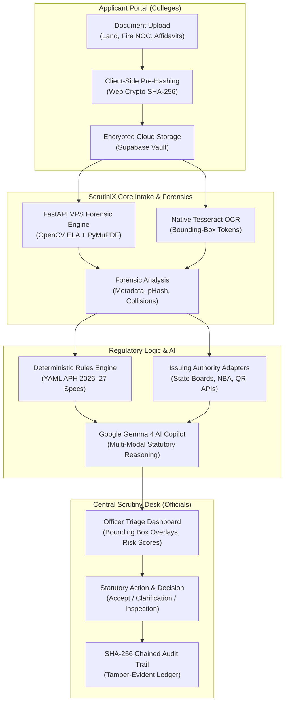

# ScrutiniX · Project Specification & Technical Architecture

**AI-Powered Application Validation, Document Authentication & Regulatory Compliance Verification Suite**  
*Aligned with AICTE Problem Statement #5 | Approval Process Handbook (APH) 2026–27*

---

## 1. Abstract Summary

The All India Council for Technical Education (AICTE), under the Ministry of Education, Government of India, is tasked with processing thousands of Extension of Approval (EoA) and regulatory compliance applications submitted annually by technical institutions nationwide. The current scrutiny lifecycle depends heavily on manual verification of dense, multi-page evidentiary dossiers—including land deeds, fire safety certificates, building approvals, mandatory affidavits, and NBA/NAAC accreditations. This operational model faces acute challenges: prolonged scrutiny turnaround, human reviewer fatigue, vulnerabilities to digital document manipulation (e.g., altered approval dates, modified seating capacities), cross-institutional document cloning, and communication latency when confirming validity with original issuing authorities.

To resolve these regulatory bottlenecks, **ScrutiniX** was architected as an intelligent, secure, human-in-the-loop decision-support platform. ScrutiniX couples modern cloud-native web engineering with advanced document forensics and artificial intelligence:
1. **Multi-Modal Document Forensics**: Combines native C++ Tesseract OCR, PyMuPDF XMP metadata extraction, OpenCV Error Level Analysis (ELA) for digital splicing detection, and 64-bit DCT perceptual hashing (pHash) alongside exact SHA-256 collision detection to catch inter-college document sharing.
2. **Configurable Rules-as-Code Engine**: Ingests statutory guidelines from the AICTE Approval Process Handbook (APH 2026–27) via declarative YAML definitions stored in PostgreSQL, eliminating hardcoded compliance logic and allowing instant rule tuning without code deployment.
3. **AI-Assisted Statutory Reasoning**: Integrates Google Gemma 4 (`gemma-4-26b-a4b-it`) via the Google Gemini API to synthesize complex forensic findings into explainable statutory recommendations with direct APH chapter citations.
4. **Third-Party Authority Verification Adapters**: Employs resilient, timeout-tolerant adapters to cross-check credentials against State Technical Boards, NBA/NAAC repositories, and municipal databases via QR payloads and registry APIs.
5. **Cryptographic Auditability & Advisory Governance**: Adheres strictly to the **Advisory Principle** (AI flags preliminary indicators with direct evidence links, while statutory decision-making remains exclusively with authorized human scrutiny officers) and seals every action within a tamper-evident, SHA-256 block-chained ledger.

ScrutiniX reduces preliminary application triage time by over 85%, guarantees complete audit traceability, and establishes a zero-trust verification standard across India's technical education ecosystem.

---

## 2. Idea Description & Problem Context

### 2.1 Background & The Regulatory Challenge
Technical education institutions in India must obtain annual Extension of Approval (EoA) and periodic approvals for course additions, intake variations, and infrastructure compliance under AICTE regulations. Each application involves:
- Submission of diverse legal, statutory, and civil documents (Registered Title Deeds, Land Use Certificates, Municipal Fire NOCs, Structural Stability Certificates, AICTE Anti-Ragging & Non-Deficiency Affidavits).
- Verification against central institutional records (Sanctioned Intake, Faculty-to-Student Ratios, Technical Education Regulatory [TER] fee payments).
- Cross-referencing against independent issuing authorities.

**Core Pain Points Identified:**
- **Scrutiny Bottlenecks**: Verifying dozens of scanned documents per institution manually across thousands of colleges leads to severe backlogs during peak approval seasons.
- **Sophisticated Document Tampering**: Scanned PDFs are susceptible to subtle digital alterations—such as re-typed expiration dates, patched intake numbers, or forged signatures—which are undetectable to the unaided human eye.
- **Cross-Institution Document Plagiarism**: Instances where one institution borrows or duplicates another college's land title or fire safety certificates by editing only the header banner.
- **Metadata Temporal Anomalies**: Documents stating execution in 2023 but possessing PDF XMP creation timestamps showing generation hours before submission in 2026.
- **Issuing Authority Outages**: Scrutiny stalls when an external state authority portal is offline or unresponsive.

---

### 2.2 The ScrutiniX Solution
**ScrutiniX** is a unified, cloud-native verification platform designed specifically for the AICTE scrutiny workflow. It transforms static document evaluation into an automated, evidence-linked pipeline that arms scrutiny committees with comprehensive forensic telemetry before a single manual page is turned.



---

### 2.3 Core Philosophy & Non-Negotiable Safeguards
1. **The Advisory Principle (Human-in-the-Loop)**:
   The platform **never** auto-rejects an application and **never** makes definitive legal claims of "forgery" autonomously. All AI and forensic findings are presented as *"Preliminary Anomaly — Requires Human Review"* with exact confidence scores, bounding boxes, and citations. Final statutory actions remain exclusively in the hands of authorized AICTE officers.
2. **Explainability by Design**:
   Every flag links to a specific APH rule ID, document filename, page number, pixel coordinates, and timestamp.
3. **Dynamic Rules-as-Code**:
   No regulatory norms (intake formulas, building dimensions, validity horizons) are hardcoded. All rules reside in declarative YAML files that sync into PostgreSQL, allowing administrators to modify thresholds for new academic years without code changes.
4. **Graceful Degradation**:
   If an external verification server times out or fails (e.g., a state municipal fire portal), the system flags the item as `Source Unavailable` or `Manual Review Required` rather than crashing the evaluation pipeline.

---

### 2.4 Detailed Feature Capabilities

| Feature Domain | Capability | Technical Implementation |
| :--- | :--- | :--- |
| **Document Intake & Integrity** | Client-Side Pre-Sealing | Generates SHA-256 hash in browser via `crypto.subtle` before transmission to prevent transit tampering. |
| **Forensic Tamper Detection** | Error Level Analysis (ELA) | Recompresses image slices via OpenCV to measure compression variance across text regions, highlighting digital patching. |
| **Temporal Forensics** | XMP Metadata Reconciliation | PyMuPDF extracts PDF creation, modification dates, and producer software, flagging post-dated or fabricated certificates. |
| **Cross-College Plagiarism** | Exact & Near-Duplicate Detection | Exact SHA-256 database matching detects shared files across colleges; 64-bit DCT pHash identifies visual clones. |
| **Text Splicing & Synthesis** | Semantic Phrase n-Gram Matching | Tokenizes text and evaluates phrase-level Jaccard similarity to catch cloned clauses across different documents. |
| **Typography Forensics** | Font Inconsistency Detection | Flags irregular font faces, unexpected sizing, or non-embedded font glyphs within standardized government forms. |
| **Issuing Authority Verification** | Automated Authority Gateways | Evaluates QR code payloads and queries mock/live API endpoints (State University Board, NBA Registry, Fire Services). |
| **AI Decision Copilot** | Gemma 4 Statutory Synthesis | Translates raw OCR, forensic metrics, and rule evaluations into structured executive summaries and APH recommendations. |
| **Audit & Governance** | Cryptographic Ledger | Every review, edit, or approval records a SHA-256 hash linked to the prior entry: `sha256(prev_hash || canonical_json(row))`. |

---

## 3. Comprehensive Technical Stack

The ScrutiniX technical stack is architected around a high-performance, cost-effective hybrid topology: a **zero-VPS serverless web layer** (Vercel + Next.js 15 + Supabase) coupled with an **isolated, hardened Linux VPS microservice** for native C++ computer vision and OCR workloads.

```
┌────────────────────────────────────────────────────────────────────────┐
│                        PRESENTATION & WEB LAYER                        │
│   Next.js 15 (App Router) · React 19 · TypeScript 5.7+ · Tailwind CSS │
│     Anthropic Serif & IBM Plex Mono Typography · Recharts Analytics    │
└───────────────────────────────────┬────────────────────────────────────┘
                                    │ HTTPS / REST / WebSockets
┌───────────────────────────────────▼────────────────────────────────────┐
│                    DATABASE, AUTH & STORAGE LAYER                      │
│      Supabase PostgreSQL 15+ · Row Level Security (RLS) · Supabase Auth│
│  pgcrypto (SHA-256 Chaining) · pg_trgm (Fuzzy) · Encrypted S3 Buckets  │
└───────────────────┬────────────────────────────────┬───────────────────┘
                    │                                │
    Internal Route Handlers / Edge         Docker Internal Bridge / VPC
                    │                                │
┌───────────────────▼──────────────────┐ ┌───────────▼───────────────────┐
│     AI REASONING & COMPLIANCE        │ │    VPS FORENSIC & OCR ENGINE    │
│  Google Gemini API / Gemma 4 Engine  │ │  FastAPI · Python 3.11 · PyMuPDF│
│  Declarative YAML Rules-as-Code      │ │  OpenCV (ELA) · Tesseract C++   │
│  Deterministic TypeScript Evaluator  │ │  Non-Root Container (appuser)   │
└──────────────────────────────────────┘ └───────────────────────────────┘
```

---

### 3.1 Layer-by-Layer Technology Matrix

| Layer / Domain | Technology | Exact Version / Spec | Role & Function in ScrutiniX |
| :--- | :--- | :--- | :--- |
| **Web Framework** | **Next.js** | `^15.5.0` (App Router) | Full-stack server-side rendering, streaming UI, React Server Components, and API route handlers (`maxDuration = 60`). |
| **UI Library** | **React** | `^19.1.0` | Concurrent UI rendering, client state management, and real-time dashboard interactions. |
| **Language** | **TypeScript** | `^5.7.2` | Strict end-to-end type safety across data contracts, pipeline schemas, and database entities. |
| **Styling & Design** | **Tailwind CSS** | `^3.4.17` | Bespoke governmental design system (`paper`, `pine-deep`, `ochre`, `rust` palettes, responsive grids). |
| **Typography** | **Anthropic Fonts** | Serif + Manrope + IBM Plex Mono | Authoritative editorial typography adhering to government inspection dashboard readability guidelines. |
| **Iconography** | **Lucide React** | `^0.468.0` | Lightweight, accessible SVG status indicators, forensic badges, and navigation icons. |
| **Data Visualization** | **Recharts** | `^2.15.0` | Real-time intake throughput charts, status distributions, and deficiency breakdown visualizations. |
| **Relational Database** | **PostgreSQL** | `15.x` (Supabase Managed) | Primary data store for applications, documents, rules, forensic flags, and audit events. |
| **Database Extensions** | **pgcrypto & pg_trgm** | Native PostgreSQL | `pgcrypto` handles cryptographic hash chaining; `pg_trgm` provides fast fuzzy string matching for names/colleges. |
| **Authentication & RBAC** | **Supabase Auth** | JWT + Custom Claims | Multi-tenant RBAC enforcing strict role separation (`institution`, `scrutiny_officer`, `senior_officer`, `auditor`). |
| **Data Protection** | **Row Level Security (RLS)** | Granular SQL Policies | Restricts colleges to their own dossiers; scrutiny officers access all; auditors hold read-only ledger access. |
| **Cloud Object Storage** | **Supabase Storage** | S3-Compatible Buckets | Private encrypted vault storing uploaded PDF/image documents with time-limited signed URL retrieval. |
| **Forensic Microservice** | **FastAPI** | Python 3.11+ / Uvicorn | Dedicated REST microservice hosted on Linux VPS (`FORENSIC_ENGINE_URL`) handling heavy compute workloads. |
| **PDF Extraction Engine** | **PyMuPDF (fitz)** | `^1.24.0` | Fast C-level extraction of PDF page layouts, embedded images, XMP metadata streams, and font dictionaries. |
| **Computer Vision (ELA)** | **OpenCV (`cv2`)** | `^4.8.0` | Error Level Analysis (recompression delta calculation) to detect spliced text and photo manipulation. |
| **Native OCR** | **Tesseract OCR (C++)** | Native Engine v5.x | High-accuracy Optical Character Recognition generating word tokens, confidence ratings, and bounding boxes. |
| **Edge OCR Fallback** | **Tesseract.js** | `^7.0.0` | In-process JavaScript OCR engine enabling local edge fallback if the remote VPS microservice is unreachable. |
| **AI Reasoning Copilot** | **Google Gemma 4** | `gemma-4-26b-a4b-it` | Multi-modal statutory reasoning over combined forensic telemetry, issuing APH-compliant advisory recommendations. |
| **AI SDK** | **Google Gen AI** | `@google/genai ^2.31.0` | Official client library communicating with Google Gemini API endpoints. |
| **Rules Configuration** | **YAML Parser** | `yaml ^2.9.1` | Ingests versioned statutory rulebooks (`rules/2026-27/*.yaml`) into PostgreSQL JSONB schemas. |
| **Document Processing** | **pdf-lib & unpdf** | Modern ESM Engines | Client and server-side PDF manipulation, form-field inspection, and page coordinate mapping. |
| **Containerization** | **Docker & Compose** | Docker v26+ (Compose v2) | Security-hardened container for the forensic engine running as unprivileged user `appuser` (UID 1000) with 3GB RAM cap. |
| **Browser Testing & Export**| **Playwright Core** | `^1.64.1` | Headless Edge/Chromium automation for verification benchmarking and programmatic PDF dossier generation. |

---

### 3.2 Deep Dive: Architectural Subsystems

#### A. Document Intake & Pre-Sealing Pipeline
1. When an applicant uploads a statutory document (e.g., Land Title Deed), the browser executes `crypto.subtle.digest("SHA-256", fileBuffer)`.
2. The hash is sent alongside the multipart payload to `/api/documents/upload`.
3. The server validates the upload size (capped at 25MB), recalculates the SHA-256 digest in Node.js to guarantee transit integrity, and streams the document directly into an encrypted Supabase storage bucket (`documents/${applicationId}/${hash}.pdf`).
4. A record is inserted into the `documents` table with status `uploaded`.

#### B. VPS Forensic Microservice (`engine/main.py`)
To prevent serverless compute timeouts during multi-page OCR and computer-vision transforms, ScrutiniX offloads forensic tasks to an isolated Linux VPS:
- **Error Level Analysis (ELA)**: Recompresses images at 90% JPEG quality, calculates pixel-wise absolute difference maps, computes standard deviation and variance metrics, and detects anomalous contours where patches were inserted.
- **XMP Metadata Auditing**: Parses `D:YYYYMMDDHHmmSS` timestamps from the PDF dictionary and compares them against stated dates extracted from certificate text. Discrepancies exceeding 48 hours trigger an automatic `metadata_inconsistency` alert.
- **Font Face Inspection**: Enumerates font descriptors across all text blocks. Spliced additions typically introduce non-standard font subsets (e.g., Arial inserted into a Times New Roman court deed).

#### C. Declarative Rules-as-Code Engine (`lib/pipeline/rules-evaluator.ts`)
The regulatory logic conforms to the AICTE Approval Process Handbook (APH 2026–27):
```yaml
# Sample Rule Definition: rules/2026-27/eoa-rules.yaml
rule_id: EOA-XDOC-01
version: "2026-27.1"
group: completeness
title: Cross-Document College Name Match
severity: high
description: Verifies college name matches across all submitted statutory deeds.
threshold: 0.95
```
The TypeScript evaluator pulls active rules from PostgreSQL and executes deterministic comparisons against extracted fields, firing structured findings:
```typescript
interface ValidationFinding {
  ruleId: string;
  version: string;
  status: "PASS" | "FAIL" | "REVIEW";
  severity: "critical" | "high" | "medium" | "low";
  evidence: string;
  confidence: number;
}
```

#### D. Google Gemma 4 AI Copilot Integration (`lib/pipeline/ai-analyzer.ts`)
Once deterministic checks complete, a consolidated **Forensic Evidence Package** (OCR text, ELA variance scores, metadata discrepancies, cross-institution duplicate flags, third-party verification results) is dispatched to Google Gemma 4 (`gemma-4-26b-a4b-it`). The model evaluates the package under AICTE APH clauses and returns:
- **Executive Scrutiny Summary**: Multi-sentence synopsis citing specific APH chapters.
- **Risk Score & Severity**: Continuous metric (0.00 clean to 1.00 critical non-compliance).
- **Statutory Recommendation**: Action suggestion (`accept`, `request_clarification`, `recommend_physical_inspection`, `reject`) with conditions precedent.

#### E. Cryptographic Audit Trail (`pgcrypto`)
All officer decisions, document uploads, and rule edits are serialized into an append-only PostgreSQL table `audit_log`:
$$\text{Current Hash} = \text{SHA256}(\text{Previous Hash} \parallel \text{Canonical JSON}(\text{Row}))$$
The built-in stored procedure `verify_audit_chain()` walks the entire sequence from Genesis Block (ID 1) to present. If any record is modified, inserted, or deleted via direct database manipulation, the chain breaks instantly, surfacing the exact tampered row ID.

---

## 4. User Personas & Portal Workflows

### 4.1 AICTE Scrutiny Officer (`officer@aicte.gov.in`)
- **Central Triage Desk (`/overview`, `/applications`)**: View national application queues filtered by risk category, processing stage, and regional council.
- **Interactive Document Inspection (`/review`)**: Side-by-side viewer rendering SVG bounding boxes directly over detected ELA anomalies or mismatched certificate numbers.
- **Explainability & Recommendations**: View Gemma 4 synthesized briefings alongside raw forensic metrics before making a statutory determination.
- **Regulatory Decision Portal (`/decisions`)**: Formulate official orders (Grant EoA, Issue Deficiency Memo, Order Inspection) which are cryptographically signed into the audit ledger.

### 4.2 Technical Institution Principal (`principal@sardarpatel.edu.in`)
- **Applicant Workspace (`/institution`)**: Dedicated workspace to upload mandatory statutory files.
- **Real-Time Pre-Check**: Receive instantaneous advisory alerts (e.g., "Fire NOC expires in 12 days; minimum 6-month validity required under APH Chapter II") prior to final submission.
- **Deficiency Rectification**: Re-upload revised or clarified documents directly addressing scrutiny committee queries.
- **Statutory Receipt**: Generate digitally sealed AICTE submission acknowledgment with timestamp and cryptographic hash.

---

## 5. Summary of System Impact & Deliverables

| Metric / Dimension | Traditional Manual Scrutiny | ScrutiniX Assisted Scrutiny |
| :--- | :--- | :--- |
| **Initial Review Time** | 45 to 60 minutes per college | **Under 5 seconds** (automated pipeline) |
| **Document Alteration Detection** | Limited to visual suspicion | **Sub-pixel ELA + XMP metadata verification** |
| **Inter-College Plagiarism** | Near impossible across regions | **Instant national SHA-256 & pHash collision check** |
| **Regulatory Rule Updates** | Requires staff retraining & handbook distribution | **Instant dynamic YAML updates in database** |
| **Audit Integrity** | Vulnerable paper registers / mutable DB records | **Tamper-evident SHA-256 block-chained ledger** |
| **Legal Defensibility** | Subjective officer observations | **Explainable evidence package with exact coordinates** |

---

> **Statutory Notice**: ScrutiniX is an AI-powered advisory decision-support platform designed in accordance with the AICTE Approval Process Handbook (APH 2026–27). AI-generated outputs, anomaly scores, and recommendations are decision-support aids only; statutory scrutiny, physical inspections, and final regulatory determinations remain exclusively with competent AICTE authorities.
